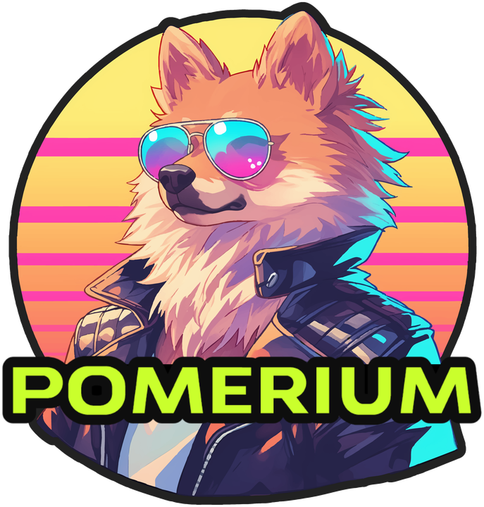
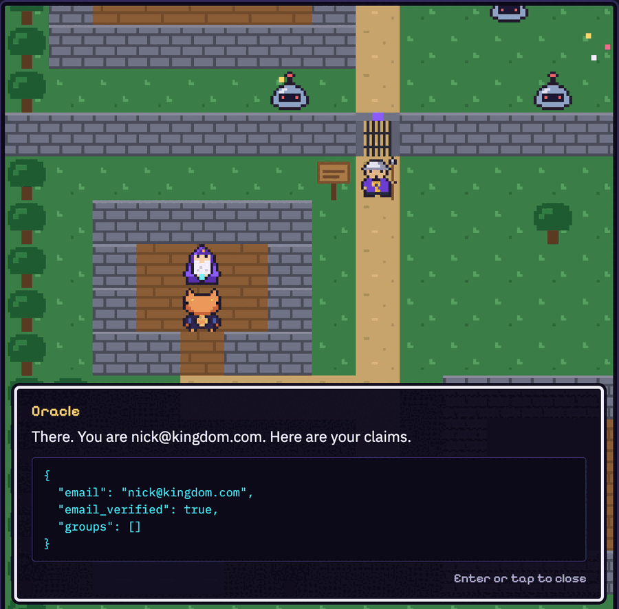
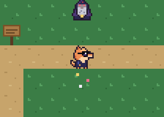
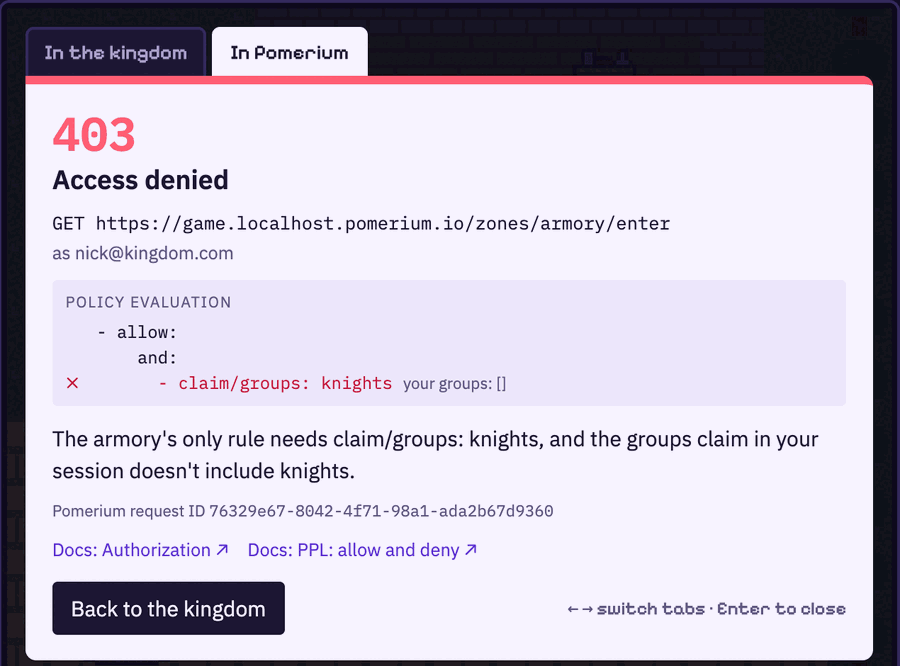
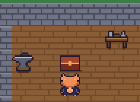
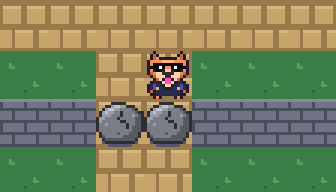
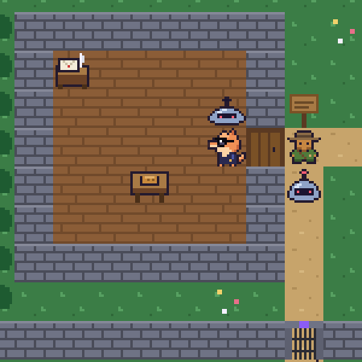
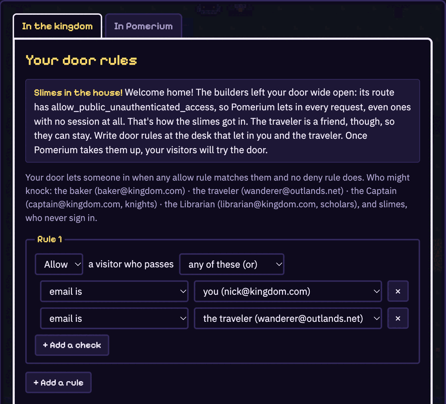
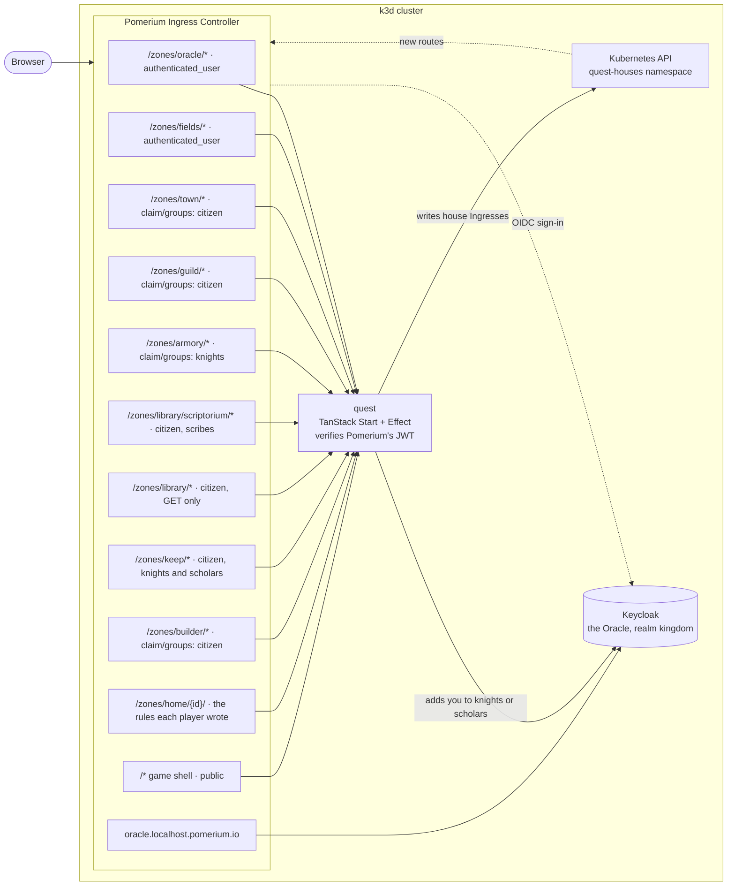
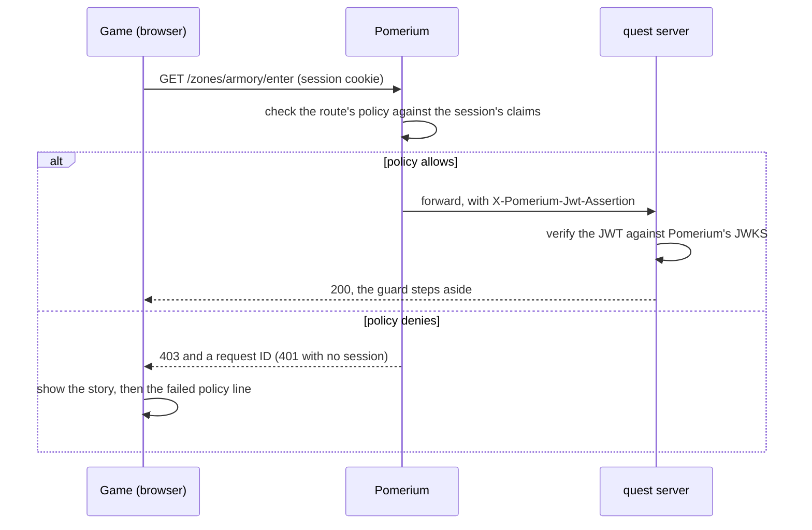

# Pomerium Quest

<p align="center">
  
</p>

A Zelda-style browser game that teaches how [Pomerium](https://www.pomerium.com) works. You play the
Pomerium Pomeranian, and every gate in the kingdom is a real Pomerium route. The guard in front of it
follows the route's real policy, and when a guard turns you away, the game shows you the exact policy rule
that failed.

Chapter one covers the fundamentals.

| In the game                                                    | In Pomerium                                                              |
| -------------------------------------------------------------- | ------------------------------------------------------------------------ |
| The Oracle signs you in                                        | Your identity provider (Keycloak, over OIDC)                             |
| Each gate's guard, and the sign beside it                      | A route and its policy                                                   |
| The Oracle makes you a citizen, and the town only admits them  | `claim/groups`, set by the IdP, not guessed from your email address      |
| The Captain makes you a knight; the armory checks it           | `claim/groups`, and claims coming from the IdP                           |
| Being knighted doesn't open the armory until you sign in again | Your session holds the claims from sign-in until Pomerium refreshes it   |
| Citizens may read the books, but not write in them             | Allow rules can check `http_method`                                      |
| Only scribes may enter the scriptorium inside the library      | A longer path can be its own route, with its own policy                  |
| The access log and the denial screen                           | Every request is checked, and denied by default                          |
| The game server knows who you are                              | Pomerium's signed `X-Pomerium-Jwt-Assertion` header, verified by the app |

Then the sage gives you a house in the Slime Fields, and you write the policy on its door yourself:

| At your house                                                  | In Pomerium                                                                           |
| -------------------------------------------------------------- | ------------------------------------------------------------------------------------- |
| Slimes walk in, because a new house is left open to everyone   | A public route (`allow_public_unauthenticated_access`), or `accept: true` in a policy |
| You write door rules at the desk                               | Your route's policy: `allow` and `deny`, `and`, `or`, `not`                           |
| You let in yourself or the traveler, and the slimes bounce off | `or`, and a request with no session matches no rule                                   |
| You drop the traveler's line, and they're refused              | No matching allow rule means no entry                                                 |
| Every citizen may visit, except the baker                      | A `deny` rule beats any `allow`                                                       |
| Knights may look in (GET) but not knock (POST)                 | `http_method`                                                                         |
| Saving door rules sends the townsfolk and a slime to your door | Real requests through Pomerium, with real sessions (or none)                          |

## How the game works

You wake up in Hearth Village. Walk around, talk to people, read the signs, and try the gates. Every gate
asks Pomerium whether to let you through, so what you can reach depends on who the Oracle says you are.

### Who's who

|                                                                  | Who                 | What they do                                                                                  |
| ---------------------------------------------------------------- | ------------------- | --------------------------------------------------------------------------------------------- |
|          | **You**             | The Pomerium Pomeranian                                                                       |
|         | **The sage**        | Starts you on the quest, and once you've signed in, points you to your house                  |
|       | **The Oracle**      | Your identity provider. He signs you in, in his temple, and grants you a deed to a house      |
|        | **A guard**         | Stands at every gate and follows that route's policy, to the letter, on every request         |
|      | **The Captain**     | Runs the Knights' Guild. Beat three bot slimes and they have the Oracle add you to `knights`  |
|      | **The Armorer**     | Keeps the forge. The armory's guard, not the Armorer, decides who gets the steel sword        |
|    | **The Librarian**   | Read every book in the library and they have the Oracle add you to `scholars`                 |
|        | **The baker**       | `baker@game.localhost.pomerium.io`, in the citizen group, so the town gate lets them in       |
|     | **The traveler**    | `wanderer@outlands.net`: signed in, but not a citizen, so the town gate turns them away       |
|        | **A phish**         | Dresses as the Oracle and offers to sign you in. Hand over your password and you lose         |
|    | **A bot slime**     | Roams the Slime Fields and bites. It never signs in, so it's a request with no session at all |
|         | **A fish**          | Swims in the ponds. Catch one to get a heart back                                             |
|  | **The steel sword** | Waits in a chest in the armory. It hits harder than your wooden one, and splits cracked rock  |

### What you can do

| To               | Keyboard                                  | Touch              |
| ---------------- | ----------------------------------------- | ------------------ |
| Move             | The arrow keys, or the W, A, S and D keys | The direction pad  |
| Talk and read    | E or Enter, facing someone or something   | A (Talk)           |
| Swing a sword    | Space or J                                | B (Sword)          |
| Open the menu    | Esc                                       | The Menu button    |
| Open the journal | I (in a narrow window)                    | The Journal button |

The menu saves your game, restarts it, quits to the title screen, and turns music and sound effects on
and off. Beside the board, your identity shows the claims in your session right now, and the access log
lists every request a guard has checked. In a narrow window or on a phone, those panels move into the
journal.

### Sign in with the Oracle

Nobody gets far without papers. The Oracle signs you in through Pomerium without leaving the game: his
temple is a real Keycloak login, and afterwards he shows you the claims Pomerium got for you.



### Fight, swim and get your strength back

Bot slimes roam the Slime Fields. They bite for a whole heart, and your wooden sword takes two swings to
pop one. The Captain wants three gone before they'll vouch for you. Run out of hearts and you wake up back
in Hearth Village, still signed in and with all your gear. Catch a fish or drink from the town fountain
to heal.

The dog can swim, too: only its head shows above the water, and it shakes itself dry on the bank.

| Fighting a bot slime                                                                                     | Swimming, then shaking dry                                                                                      |
| -------------------------------------------------------------------------------------------------------- | --------------------------------------------------------------------------------------------------------------- |
|  |  |

### Get turned away

When a guard says no, it's because Pomerium said no. The refusal tells the story first. Its second tab
shows the request Pomerium checked, the route's policy with the line that failed, and Pomerium's request
ID.



### Earn the steel sword

The Captain knights you, but the armory still says no: your session holds the claims you had when you
signed in. Sign in with the Oracle again, and the armory's guard lets you through to the chest. The
steel sword splits the cracked rocks that block the road to the library.

| Opening the armory's chest                                                                                  | Splitting the rocks                                                                                            |
| ----------------------------------------------------------------------------------------------------------- | -------------------------------------------------------------------------------------------------------------- |
|  |  |

From there, the library lets citizens read but only scribes into its scriptorium, the Librarian can make you a scholar,
and the Royal Keep at the end of the road wants a citizen who is a knight and a scholar at once.

### Write the rules on your own door

The sage gives you a house in the Slime Fields. Its door is a real Pomerium route too, and it starts
public, so slimes walk right in. Letters on your desk ask for door rules, one lesson at a time, and the
rules you write become the route's policy. Save them, and the townsfolk and a slime come and knock,
signed in as themselves (or not at all), so you see what Pomerium does with your policy.

| A public door                                                                                                         | Writing the rules                                                                                                               |
| --------------------------------------------------------------------------------------------------------------------- | ------------------------------------------------------------------------------------------------------------------------------- |
|  |  |

## Play it on a real Pomerium (local k3d)

You need Docker, [k3d](https://k3d.io), [kubectl](https://kubernetes.io/docs/tasks/tools/),
[mkcert](https://github.com/FiloSottile/mkcert) and Node 24. The repo pins Node in `mise.toml`, so with
[mise](https://mise.jdx.dev), `mise install` gets the right version. `./quest` is a Bash script.

### macOS

Use Docker Desktop, OrbStack or Colima for Docker, then:

```sh
brew install k3d kubectl mkcert node
./quest up
```

### Linux

Install [Docker Engine](https://docs.docker.com/engine/install/) (or Docker Desktop), and make sure you can
run `docker` without `sudo`. Then install the rest. With [Homebrew on Linux](https://docs.brew.sh/Homebrew-on-Linux),
the macOS line above works as is. Without it:

```sh
curl -s https://raw.githubusercontent.com/k3d-io/k3d/main/install.sh | bash   # k3d
sudo apt install libnss3-tools   # lets mkcert add its certificate to Chrome and Firefox (Debian, Ubuntu)
```

Then install kubectl ([instructions](https://kubernetes.io/docs/tasks/tools/install-kubectl-linux/)), mkcert
([instructions](https://github.com/FiloSottile/mkcert#linux)) and Node 24 (`mise install`), and run
`./quest up`. Rootless Docker can't listen on port 443, so with it, run `QUEST_PORT=8443 ./quest up`.

### Windows

Run `./quest` inside [WSL 2](https://learn.microsoft.com/windows/wsl/install), and play in your usual
Windows browser. (It may also run in Git Bash, but that hasn't been tried.)

1. Install [Docker Desktop](https://docs.docker.com/desktop/setup/install/windows-install/) with the WSL 2
   backend, and turn on WSL integration for your distribution (Settings → Resources → WSL integration).
2. In PowerShell, install mkcert on Windows and trust its certificate authority, so Windows browsers
   trust the game's certificate:

   ```powershell
   choco install mkcert   # or: scoop bucket add extras; scoop install mkcert
   mkcert -install
   ```

3. In your WSL distribution, follow the Linux steps above (skip Docker Engine: Docker Desktop provides
   `docker`). Before the first `./quest up`, point WSL's mkcert at the Windows certificate authority, so
   the certificate it makes is one Windows trusts:

   ```sh
   export CAROOT="/mnt/c/Users/<your Windows user name>/AppData/Local/mkcert"
   ./quest up
   ```

   Clone the repo inside WSL (say, `~/pomerium-quest`), not under `/mnt/c`: builds are much faster, and
   `./quest dev` can see file changes. If you already ran `./quest up` without `CAROOT`, delete
   `.quest/certs` and run it again.

### Then

Open **https://game.localhost.pomerium.io**. Move with the arrow keys or the W, A, S and D keys, talk with E or Enter,
swing with Space or J, and press Esc for the menu (save, restart, quit to title, and turn music or sound effects on and off). `*.localhost.pomerium.io` resolves to `127.0.0.1`, so you
don't need to edit `/etc/hosts`. mkcert creates a locally trusted certificate, and may ask for your
password the first time.

| Command                 | What it does                                                                            |
| ----------------------- | --------------------------------------------------------------------------------------- |
| `./quest up`            | Create the cluster if needed, build the images, deploy, and wait until the game answers |
| `./quest dev`           | Same as `up`, but the game runs its Vite dev server and hot-reloads `app/src`           |
| `./quest deploy`        | Rebuild and redeploy into the existing cluster                                          |
| `./quest test`          | Sign players in through Pomerium with curl and check every zone policy and house        |
| `npm test`              | Run the unit tests for the policy evaluator, house rule validation and statecharts      |
| `./quest status`        | Show the pods, services and Ingresses                                                   |
| `./quest logs pomerium` | Follow logs (`pomerium`, `quest` or `keycloak`)                                         |
| `./quest admin`         | Open Keycloak's admin console on http://localhost:8080 and print its password           |
| `./quest reset-oracle`  | Forget every player and re-import the Keycloak realm                                    |
| `./quest down`          | Delete the cluster                                                                      |

`./quest dev` (and `./quest up`) take a minute or two to start the cluster, build the images and bring up Keycloak. Wait
for the `Ready:` line before you open the game.

Port 443 already in use? Run `QUEST_PORT=8443 ./quest up` and open `https://game.localhost.pomerium.io:8443`.

### Settings

`./quest` reads these environment variables. Set them the same way for every command, since each deploy
renders the config again:

| Variable       | Default                 | What it sets                                                      |
| -------------- | ----------------------- | ----------------------------------------------------------------- |
| `QUEST_PORT`   | `443`                   | The port Pomerium listens on                                      |
| `QUEST_DOMAIN` | `localhost.pomerium.io` | The domain the game, the Oracle and Pomerium's sign-in live under |

Keycloak only imports its realm on first start, so after changing either of these on an existing cluster,
run `./quest reset-oracle` too. After changing `QUEST_DOMAIN`, also delete `.quest/certs` so mkcert makes a
certificate for the new domain.

The game only plays behind Pomerium. Opened directly (say, `npm run dev -w app` on
http://localhost:3000), it says so and won't start: use `./quest dev` for hot reload behind
Pomerium and Keycloak.

## Architecture

Three services run in a local k3d cluster: Pomerium, the game (`quest`), and Keycloak (the Oracle).
Every request from the browser goes through Pomerium first, including the game itself:



### What happens at a gate

The game never decides who gets in. When the dog walks into a gate:



1. The scene ([`scene.ts`](app/src/game/scene.ts)) hands the gate to [`story.ts`](app/src/game/story.ts),
   which asks [`access.ts`](app/src/game/access.ts) to make a real request through Pomerium:
   `fetch('/zones/armory/enter')`, as a GET.
2. Pomerium checks the request against that route's policy, using the claims in the player's session.
3. If the policy allows it, Pomerium forwards the request to the game server with a signed
   `X-Pomerium-Jwt-Assertion` header. The server checks the signature against Pomerium's JWKS, and the
   guard steps aside. If it doesn't, Pomerium answers 403 (or 401 with no session), and the gate stays
   shut.
4. On a refusal, the game shows the route's rules and marks which line failed and why. That
   explanation comes from a small PPL evaluator ([`ppl.ts`](app/src/game/ppl.ts)) running the same
   rules from `zones.ts` against your claims. It only explains the answer; the answer is Pomerium's.

Every check also lands in the access log beside the board, and a denial screen shows Pomerium's request
ID.

### One source of truth for policy

[`app/src/game/zones.ts`](app/src/game/zones.ts) defines every zone and its rules.
[`scripts/render.ts`](scripts/render.ts) turns that list into an Ingress per zone, the Keycloak realm and
the other Kubernetes manifests (`deploy/.generated/`), and the game's signs and denial screens show the
same rules. So what a sign says, what a guard does and what Pomerium enforces can't drift apart.
Players' houses are the one exception: their policy comes from the player.

### The pieces

- **Pomerium is the [Pomerium Ingress Controller](https://www.pomerium.com/docs/deploy/k8s/ingress)**
  (branch 0-33-0, which embeds Pomerium v0.33.4), in the `pomerium` namespace. Its global settings are
  a `Pomerium` resource, and every route is an Ingress. The install is vendored in
  [`deploy/pomerium/ingress-controller.yaml`](deploy/pomerium/ingress-controller.yaml).
- **Players' houses** ([docs/prd/your-house.md](docs/prd/your-house.md)) are Ingresses the game server
  writes into the `quest-houses` namespace, the only one its ServiceAccount may change. The owner
  always comes from Pomerium's verified JWT, and door rules are checked against a strict schema before
  the server renders them as PPL. A house starts public, comes down after 30 minutes without a visit,
  and at most 100 stand at once: past a few hundred, the Ingress Controller slows down, and at 1,000 it
  can't start (see the load test in the plan, and `scripts/house-load-test.sh`).
- **The townsfolk** (the baker, the traveler, the Captain and the Librarian) have real Oracle
  accounts, which `./quest` imports at every deploy. The game server signs them in through Pomerium and
  knocks on houses as them; a slime is a knock with no session at all.
- **The game** ([`app/`](app)) is a TanStack Start app in SPA mode with a Phaser overworld and a React
  UI around it. Its `/zones/*` server routes use Effect 4 to verify Pomerium's signed JWT against
  Pomerium's JWKS and to call the Oracle.
- **The Oracle** is [Keycloak](https://www.keycloak.org). `scripts/render.ts` writes its `kingdom`
  realm: open sign-up, the `knights` and `scholars` groups, a mapper that puts them in a `groups`
  claim, Pomerium's client, and a `quest-admin` client whose service account lets the game add a
  player to a group. Its login theme lives in [`deploy/keycloak/theme`](deploy/keycloak/theme) and
  matches the game. Only `/realms/kingdom/` and `/resources/` are routed through Pomerium; the admin
  console stays inside the cluster (`./quest admin`).
- **Kubernetes:** NetworkPolicies allow only Pomerium to reach the game, and only Pomerium and the game
  to reach the Oracle. A CoreDNS rewrite sends in-cluster requests for `*.localhost.pomerium.io` to
  Pomerium, so the game can fetch Pomerium's JWKS and knock on houses.

### Inside the browser

The board is a [Phaser](https://phaser.io) scene; everything around it (dialogs, the sign-in frame,
denial screens, the identity panel, the access log, the door-rules editor and the menu) is React. The
two share one small store ([`store.ts`](app/src/game/store.ts)): Phaser writes the player's position,
health and region to it, and React writes the controls, so the touch buttons drive the same code as the
keyboard.

Progress lives in three [XState](https://stately.ai/docs/xstate) statecharts, saved to local storage:

| Machine                                               | Tracks                                                                           |
| ----------------------------------------------------- | -------------------------------------------------------------------------------- |
| [`quest-machine.ts`](app/src/game/quest-machine.ts)   | Chapter one: anonymous → citizen → proven → knighted → knight → armed            |
| [`house-machine.ts`](app/src/game/house-machine.ts)   | Your house: one stage per letter on the desk, solved by real visits              |
| [`player-machine.ts`](app/src/game/player-machine.ts) | The dog: walking, waiting on a gate, swinging, and a moment's safety after a hit |

`knighted` is the stage the chapter turns on: the Oracle lists you in `knights`, but your Pomerium
session still holds the claims from when you signed in, so the armory says no until you sign in again.

The art and sound are code too. The sprites and tiles are pixel grids in [`art/`](art) that
`node art/sprites.mjs` draws into sprite sheets, and there are no audio files: every note of music and
every sound effect is synthesized at runtime with the Web Audio API ([`sound.ts`](app/src/game/sound.ts)).

### On the server

The server is a handful of [Effect](https://effect.website) services behind one catch-all route,
[`routes/zones/$.ts`](app/src/routes/zones/$.ts). By the time a request reaches it, Pomerium has already
allowed it.

| Service                                          | Job                                                                                   |
| ------------------------------------------------ | ------------------------------------------------------------------------------------- |
| [`PomeriumIdentity`](app/src/server/identity.ts) | Verifies `X-Pomerium-Jwt-Assertion` against Pomerium's JWKS: who is asking            |
| [`OracleAdmin`](app/src/server/oracle-admin.ts)  | Adds a player to `knights` or `scholars` in Keycloak, as the Captain or the Librarian |
| [`Houses`](app/src/server/houses.ts)             | Renders a player's door rules as PPL and writes their house's Ingress                 |
| [`Visitors`](app/src/server/visitors.ts)         | Signs the townsfolk in through Pomerium and knocks on a house as them                 |
| [`Kube`](app/src/server/kube.ts)                 | Talks to the Kubernetes API with the pod's ServiceAccount                             |

### Where things live

| Path                      | What it is                                                                     |
| ------------------------- | ------------------------------------------------------------------------------ |
| `app/src/game/zones.ts`   | Every zone and its policy                                                      |
| `scripts/render.ts`       | Turns `zones.ts` into the Pomerium config, Keycloak realm and Kubernetes files |
| `app/src/game/scene.ts`   | The Phaser overworld: movement, sword, monsters, drawing                       |
| `app/src/game/story.ts`   | Talking, reading and gates: everything that asks Pomerium a question           |
| `app/src/game/content.ts` | What characters say, what signs show, and the docs each lesson links to        |
| `app/src/game/house*.ts`  | The player's house: its visitors, its statechart, and its letters and bell     |
| `app/src/components/`     | The React UI around the game                                                   |
| `app/src/server/`         | The server's Effect services                                                   |
| `deploy/`                 | The vendored Pomerium Ingress Controller install and the Oracle's login theme  |
| `art/`                    | Pixel art as code                                                              |
| `docs/prd/`               | Plans for work not yet built                                                   |

### Things worth knowing

- **Anyone can sign up, and the game makes them a citizen.** The realm takes any email without verifying it.
  Being a citizen is the `citizen` group, and owning a house is a `deed` claim. The Oracle grants both in the game
  (see `POST /zones/oracle/citizen`); no address proves either. That's fine for a learning game. Never reuse the realm, or this
  Pomerium, for anything real.
- **Keycloak runs in dev mode** (`start-dev`) with its H2 database on a volume, so players survive a
  redeploy. It imports the realm on first start only: after changing the realm in `render.ts`, or
  `QUEST_DOMAIN`/`QUEST_PORT`, run `./quest reset-oracle`. (`./quest dev` and `./quest deploy` do create any group the townsfolk need, such as `citizen`, if an older realm lacks it, so a new group alone needs no reset.) A public deployment should run
  `start` with a real database.
- **Signing in again signs you out of Keycloak too.** Pomerium's sign-out calls Keycloak's
  end-session endpoint, so refreshing your claims asks for your password again.
- **New claims take a moment.** After you sign in again, Pomerium's authorize service can take up to
  about a minute to use the new claim. Until then the armory still answers 403.
- **`groups` vs `claim/groups`.** The `groups` PPL criterion is Pomerium Enterprise only (it needs
  directory sync). Open-source Pomerium checks the IdP's claim with `claim/groups`.
- **Signing out lands where the game asks.** The Ingress Controller's settings have no
  `signout_redirect_url`, so the game passes `pomerium_redirect_uri` (allowed by the
  `allow_any_sign_out_redirect_uri` runtime flag) to land back at sign-in or on the title screen.
- **PPL operators don't nest.** `and`/`or` hold criteria, not other operators. "Citizen and (GET or
  scribe)" is written as two allow rules, and a request is allowed when any rule matches.

## Development

```sh
npm install
npx vp check      # oxfmt + oxlint (with the vendored anti-slop rules) + type checks
node art/sprites.mjs   # regenerate sprite sheets from the pixel grids in art/
node art/og.ts         # redraw the repo's social preview (needs Chrome); upload it in Settings
```

Node is pinned with [mise](https://mise.jdx.dev) (`mise.toml`). Lint and format run through
[Vite+](https://viteplus.dev). The anti-slop rules are vendored from
[dmmulroy/anti-slop](https://github.com/dmmulroy/anti-slop) in `tools/oxlint/anti-slop`.

## License

[Apache License 2.0](LICENSE). The vendored anti-slop lint rules in `tools/oxlint/anti-slop` keep their
own MIT license.
